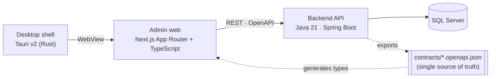

# Itera (code name AeroCore)

여행 패키지(출발일 · 가격 · 예약)를 다루는 관리자 플랫폼입니다. Java 백엔드, Next.js 관리자 웹, Tauri 데스크톱 셸로 이루어진 모노레포이고, **REST 계약(OpenAPI)을 단일 원천**으로 삼아 서버와 클라이언트가 어긋나지 않게 만든 것이 구조의 중심입니다.

> **License: view only.** 소스를 읽고 평가하는 것만 허용합니다. 복사, 수정, 재배포, 상업적 사용은 허용하지 않습니다([LICENSE](LICENSE)).
> English: a personal portfolio project. The source is public for reading and evaluation only (see LICENSE).

---

## 무엇을 하나

- **모상품 + 가상 출발일**: 출발일을 행으로 미리 만들지 않고 출발 규칙(기간 · 요일 · 제외일)에서 계산합니다. 예약이나 관리자 조치가 있는 날짜만 저장합니다. ([설계](docs/design/package-departure.md))
- **원가 기반 가격**: 원가 항목 + 마진(율 + 고정)으로 판매가를 계산하고, 날짜별 원가 조정과 채널별 수수료를 지원합니다. 모두 정수 연산입니다. ([설계](docs/design/package-pricing.md))
- **예약**: 좌석 확보 → 결제 대기 → 확정/만료/취소(위약금)의 상태 흐름. 좌석 정합성은 서버 트랜잭션이 보장합니다. ([설계](docs/design/package-booking.md))
- **관리자 웹**: 대시보드, 예약 관리, 상품 · 출발 규칙 · 일정 · 원가 편집, 출발 달력, 채널 수수료.
- **데스크톱 셸**: 같은 관리자 웹을 담는 얇은 Tauri 앱(Windows, macOS). 제목 표시줄은 웹이 그립니다.

## 구조



| 위치 | 내용 |
| :--- | :--- |
| `services/backend-api` | Spring Boot REST 백엔드. 예약 상태 머신, 좌석 정합성, 가격 계산. `memory` 프로필은 DB 없이 전체가 돈다. |
| `contracts/` | 컨트롤러에서 생성한 OpenAPI(public, admin). 어긋나면 테스트가 실패한다. |
| `apps/admin` | 관리자 웹(Next.js 16, Tailwind 4). 서버 컴포넌트와 서버 액션이 백엔드를 호출한다. |
| `apps/desktop-shell` | Tauri v2 셸. UI를 담지 않고 설정한 웹 주소를 연다. ([README](apps/desktop-shell/README.md)) |
| `packages/api-client` | 계약에서 생성한 타입 클라이언트 |
| `packages/domain` | 레이블, 포맷, 폼 → 요청 변환(zod). 비즈니스 규칙은 없다. |
| `packages/ui`, `theme`, `token` | Tailwind 프리미티브, 테마, 디자인 토큰 |
| `e2e/` | Playwright E2E (백엔드 `memory` 프로필 위에서 실행) |
| `services/gds-adapter` | GDS 연동 계층의 포트-어댑터 스케치. 시뮬레이션이며 벤더 SDK는 없다. |
| `docs/` | 설계 문서, ADR, 학습 노트 |

설계에서 지키는 규칙: 계약이 먼저(DTO를 클라이언트에서 손으로 정의하지 않음) · 비즈니스 로직은 Java에만 · 셸에는 UI를 두지 않음. 자세한 것은 [AGENTS.md](AGENTS.md), 프런트엔드 계층은 [frontend-architecture](docs/design/frontend-architecture.md)에 있습니다.

## 실행

준비물: JDK 21+, Node.js 20+ 와 pnpm 10, (셸을 빌드하려면) Rust. 처음 한 번 `pnpm install`.

**DB 없이 (가장 빠름)** — 샘플 상품이 들어 있는 `memory` 프로필:

```bash
cd services/backend-api && ./gradlew bootRun --args='--spring.profiles.active=memory'   # :8080
API_BASE_URL=http://localhost:8080 pnpm --filter @itera/admin dev                        # :3000
```

관리자 로그인은 `services/backend-api/src/main/resources/application-memory.properties`의 개발용 값입니다(운영에 쓰지 않음).

**SQL Server와 함께 (Docker)**:

```bash
cp .env.example .env        # 값을 바꾸세요
docker compose up -d --build
```

## 검증

```powershell
pwsh -ExecutionPolicy Bypass -File .\check_all.ps1          # 전체 (계약 · domain · ui · 경계 · Java · Rust · Next 빌드)
pwsh -ExecutionPolicy Bypass -File .\check_all.ps1 -E2E     # + Playwright E2E
```

경계 규칙(패키지 계층, feature 격리, 순환 금지)은 dependency-cruiser로 검사합니다(`pnpm check:boundaries`). CI는 같은 검사를 GitHub Actions에서 실행합니다.

## 데스크톱 앱 받기

[Releases](../../releases)에서 Windows 설치 파일(NSIS)과 macOS(dmg)를 받을 수 있습니다. **서명되지 않았습니다.** Windows SmartScreen은 "추가 정보 → 실행", macOS는 우클릭 → 열기로 첫 실행합니다. 앱은 기본으로 `http://localhost:3000`을 열고, 다른 서버는 환경 변수 `ITERA_WEB_URL`로 지정합니다.

## 문서

- [ADR-001: 아키텍처 수렴](docs/adr/ADR-001-architecture-convergence.md)
- [프런트엔드 아키텍처](docs/design/frontend-architecture.md)
- [패키지 출발일](docs/design/package-departure.md) · [가격](docs/design/package-pricing.md) · [예약](docs/design/package-booking.md)
- [Agent 작업 규칙](AGENTS.md)

예시 데이터와 문구는 모두 가상의 샘플입니다.
