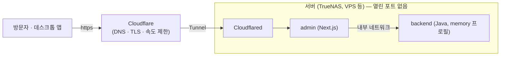

# 공개 데모 배포 (Cloudflare Tunnel + 컨테이너)

누구나 접속해 볼 수 있는 풀스택 데모를 `delete-horizon.com`의 서브도메인(예: `itera.delete-horizon.com`)에 올리는 방법입니다. DB 없이 백엔드의 `memory` 프로필(샘플 데이터)로 돌고, 일정 주기마다 샘플 상태로 초기화됩니다.



- 서버에서 **밖으로 나가는 연결**(cloudflared → Cloudflare)만 있고, 포트를 열거나 공인 IP를 노출하지 않습니다.
- 백엔드는 인터넷에 공개되지 않습니다. 브라우저는 관리자 웹하고만 통신하고, 웹이 서버 쪽에서 백엔드를 호출합니다.

## 1. 이미지 (GitHub Container Registry)

`images.yml` 워크플로가 백엔드와 관리자 웹을 컨테이너 이미지로 만들어 `ghcr.io/grangbelrlurain/itera-backend`, `itera-admin`으로 올립니다(`v*` 태그를 올리거나 Actions에서 수동 실행). 서버는 이미지를 받기만 하므로 빌드 도구가 필요 없습니다.

- 이미지는 `linux/amd64`만 만듭니다(TrueNAS, 일반 VPS). ARM 서버(예: Oracle ARM 무료 VM)는 멀티 아키텍처 빌드를 추가해야 합니다.
- 처음 올라간 패키지의 공개 여부는 GitHub의 패키지 설정에서 확인하세요. 서버가 로그인 없이 받으려면 **Public**이어야 합니다.

## 2. Cloudflare 설정

1. Cloudflare 대시보드의 **Zero Trust → Networks → Tunnels**에서 터널을 만들고 **토큰**을 복사합니다(터널을 실행할 수 있는 비밀입니다).
2. 터널의 **Public hostname**에 `itera.delete-horizon.com`(원하는 서브도메인)을 추가하고 서비스를 **HTTP** `admin:3000`으로 지정합니다. DNS 레코드는 Cloudflare가 자동으로 만들어 줍니다.
3. **속도 제한(WAF → Rate limiting rules)**: 무료 플랜에서도 규칙 1개를 쓸 수 있습니다. 예: 호스트가 위 서브도메인이고 같은 IP에서 10초에 100건을 넘으면 1분간 차단. 앱에도 방문자별 제한이 있지만(아래), 이쪽이 서버에 닿기 전에 막아 줍니다.

> 메뉴 이름과 위치는 Cloudflare가 바꿀 수 있습니다. 위 항목은 "터널 만들기 → 공개 호스트 이름 연결 → 속도 제한 규칙"의 순서를 가리킵니다.

## 3. 서버에서 실행

`deploy/demo/compose.yml`을 사용합니다.

```bash
cd deploy/demo
cp .env.example .env      # TUNNEL_TOKEN, ADMIN_PASSWORD, ADMIN_TOKEN_SECRET, DEMO_NOTICE를 채웁니다
docker compose up -d
docker compose logs -f admin
```

값 설명은 `.env.example`에 있습니다. 핵심만 적으면 다음과 같습니다.

| 변수 | 내용 |
| :--- | :--- |
| `TUNNEL_TOKEN` | 2단계에서 복사한 토큰 |
| `ADMIN_PASSWORD` | 데모 계정 비밀번호. 로그인 화면에 안내되므로 **다른 곳에서 쓰지 않는 값**으로 |
| `ADMIN_TOKEN_SECRET` | 로그인 토큰 서명용 긴 임의 문자열 (`openssl rand -hex 32`) |
| `DEMO_NOTICE` | 로그인 화면에 보이는 안내(계정, 초기화 주기). `ADMIN_PASSWORD`와 같은 값을 적어 줍니다 |
| `MEMORY_RESET_INTERVAL` | 샘플 상태로 되돌리는 주기(기본 `PT6H`) |
| `RATE_LIMIT_READS_PER_MINUTE` / `..._WRITES_PER_MINUTE` | 방문자별 분당 페이지 조회 / 폼 제출 한도(기본 120 / 30) |

### TrueNAS

TrueNAS의 앱 설치 화면에서 **Install via YAML**(Custom App)로 `compose.yml` 내용을 붙여 넣고, `${...}` 자리에는 값을 직접 적습니다. 메뉴 이름은 TrueNAS 버전마다 다르니 사용 중인 버전의 문서를 확인하세요. 이 compose는 포트를 게시하지 않으므로 NAS의 다른 서비스와 포트가 겹치지 않고, 앱 데이터를 저장하는 볼륨도 필요 없습니다(상태는 메모리뿐입니다).

### 다른 무료 서버

컨테이너를 돌릴 수 있고 바깥으로 나가는 연결이 되면 어디서든 됩니다. 메모리는 백엔드 약 300MB, 웹 약 50MB면 충분합니다(합쳐서 1GB 안팎의 서버면 여유 있습니다). 유휴 시 잠드는 서비스에서는 첫 접속이 느릴 수 있는데, 데스크톱 앱의 스플래시가 연결될 때까지 재시도합니다.

## 4. 데스크톱 앱이 이 주소를 기본으로 열게 하기

릴리스 워크플로는 저장소 변수 `ITERA_DEFAULT_WEB_URL`을 설치 파일의 기본 주소로 넣습니다. 서버가 뜬 것을 확인한 뒤에 설정하고 새 버전을 냅니다.

```bash
gh variable set ITERA_DEFAULT_WEB_URL --body https://itera.delete-horizon.com
git tag v0.1.1 && git push origin v0.1.1      # 설치 파일 초안이 만들어집니다
```

변수가 없으면 기본 주소는 `http://localhost:3000`입니다. 사용자는 언제든 환경 변수 `ITERA_WEB_URL`로 바꿀 수 있습니다. 변수에는 **공개해도 되는 주소만** 넣으세요. 설치 파일은 공개됩니다.

## 5. 운영과 안전

- **누구나 데이터를 바꿀 수 있습니다.** 데모 데이터는 가상의 샘플이고, 메모리에만 있으며 주기적으로 초기화됩니다. 실제 개인정보를 넣지 말라고 `DEMO_NOTICE`에 적어 두세요.
- **속도 제한은 두 겹입니다.** Cloudflare 규칙(서버에 닿기 전) + 앱의 방문자별 카운터. 앱 쪽은 프로세스 메모리에만 있어서 재시작하면 0으로 돌아가고, 방문자 구분을 Cloudflare 헤더(`CF-Connecting-Ip`)에 의존합니다. 그래서 `TRUST_PROXY_HEADERS=true`는 **터널 뒤에서만** 켭니다(포트를 직접 열면 헤더를 위조할 수 있습니다).
- **초기화 엔드포인트(`POST /api/test/reset`)는 꺼져 있습니다.** 인증이 없어서 데모 환경에서는 `MEMORY_RESET_ENDPOINT`를 설정하지 않습니다.
- 컨테이너는 root가 아닌 사용자로 실행되고, 권한(capabilities)을 모두 버리고, 메모리 상한이 있습니다.
- **업데이트**: 새 이미지가 올라온 뒤 `docker compose pull && docker compose up -d`.
- **비용**: Cloudflare 터널과 기본 속도 제한, GHCR(공개 패키지)은 무료입니다. 서버 비용은 선택에 따라 다릅니다.
