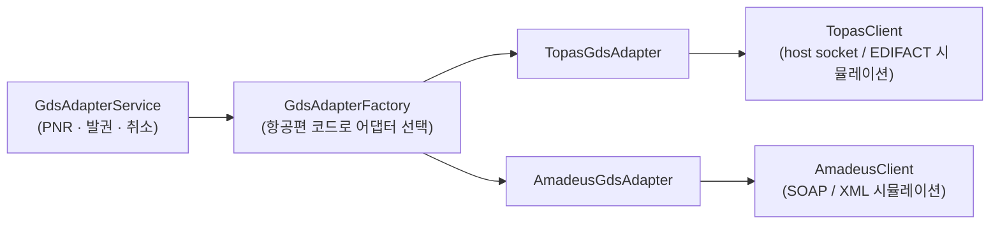

# GDS adapter (simulated)

GDS(항공 예약 시스템) 연동 계층을 **포트-어댑터(헥사고날)** 구조로 어떻게 격리할지 보여주는 작은 Java 모듈입니다. 실제 벤더 SDK, 실제 호스트, 실제 전문(프로토콜) 구현은 **없습니다.** 클라이언트는 모두 시뮬레이션입니다. 백엔드(`services/backend-api`)와는 아직 연결되어 있지 않습니다.

## 왜 이런 모양인가

GDS마다 통신 방식과 오류 코드가 다릅니다. 호출하는 쪽이 그 차이를 알지 않도록 한 가지 포트(`GdsAdapter`)만 보게 하고, 항공사 코드로 어댑터를 고릅니다.



- `adapter/`: 포트 `GdsAdapter`, 구현 두 개, 라우팅 팩토리
- `client/`: 하위 통신을 흉내 내는 클라이언트
- `model/`: 요청과 응답 DTO(PNR, 발권 명령과 결과)
- `service/`: 어댑터를 골라 호출하는 오케스트레이션

## 실행

JDK 17 이상, 외부 의존성 없음.

```powershell
cd services/gds-adapter
javac -d bin (Get-ChildItem -Recurse -Filter "*.java").FullName
java -cp bin aerocore.gds.GdsAdapterTest   # 자체 포함 테스트
java -cp bin aerocore.gds.Main             # 데모
```

`check_all.ps1`가 같은 방식으로 컴파일하고 테스트를 실행합니다.
